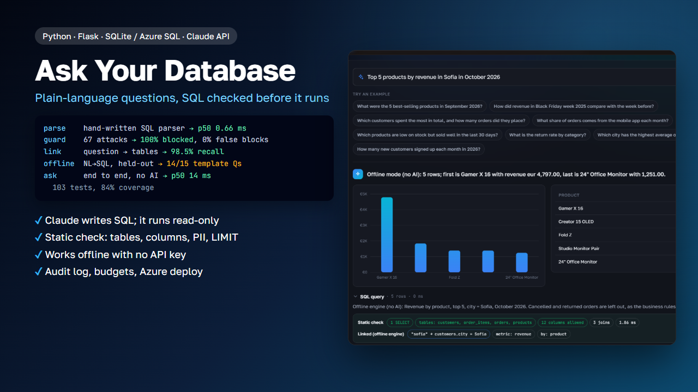
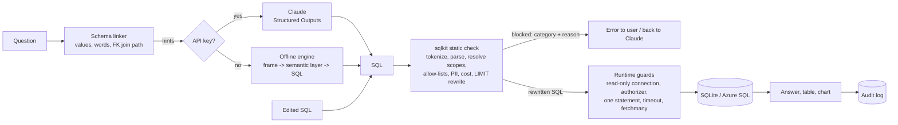
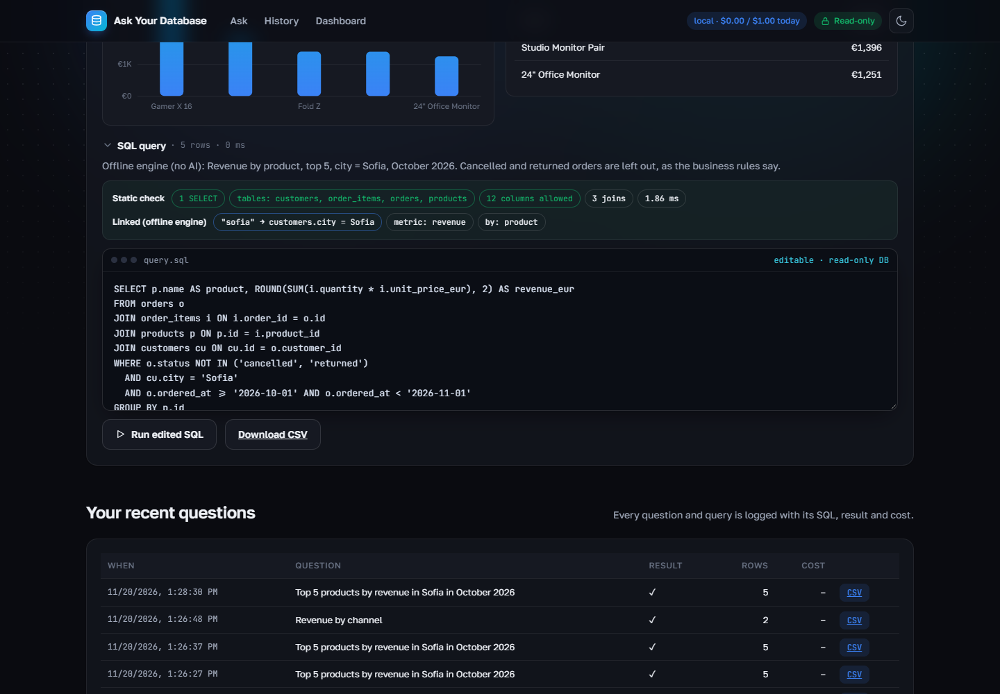
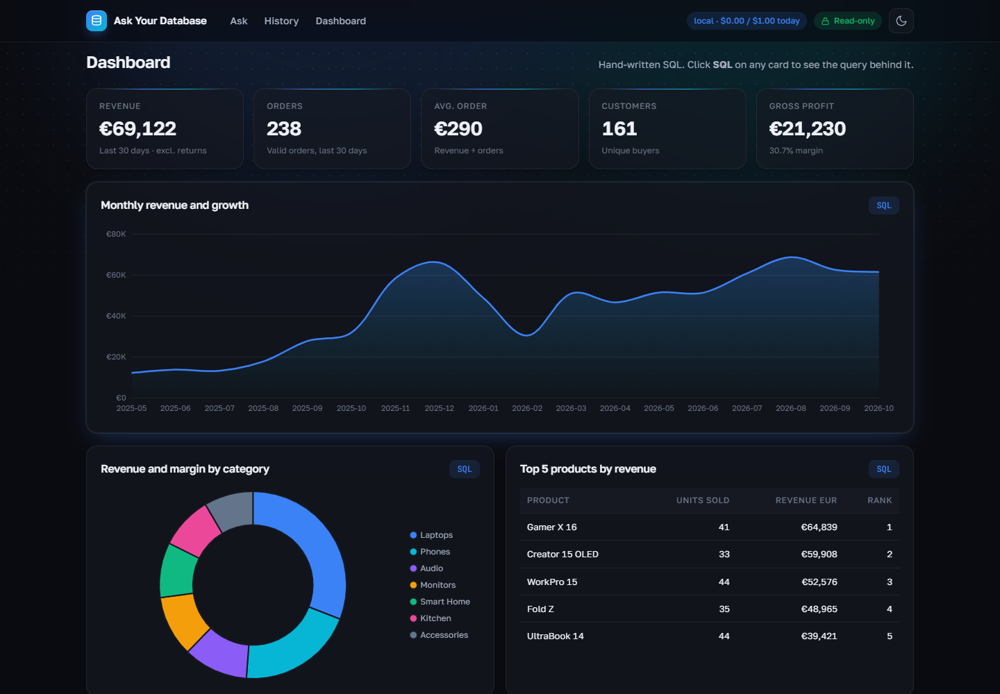
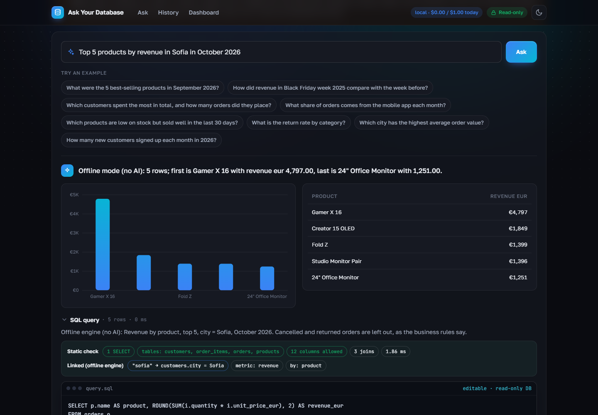
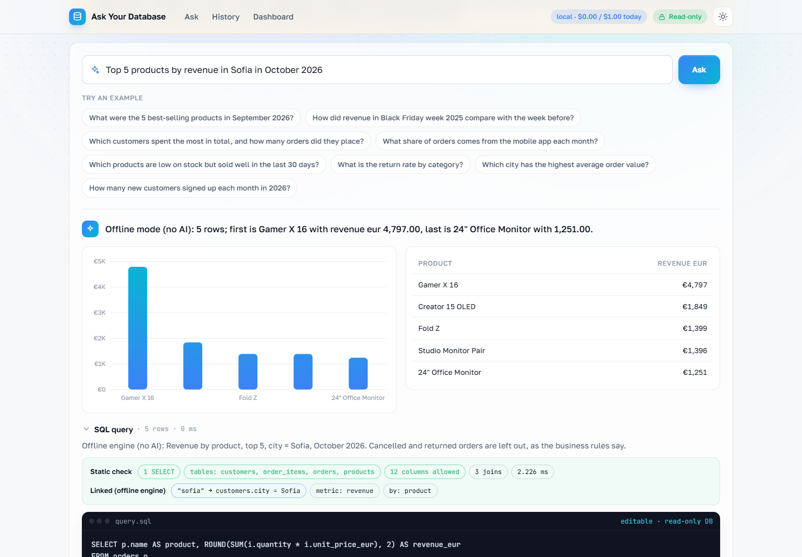
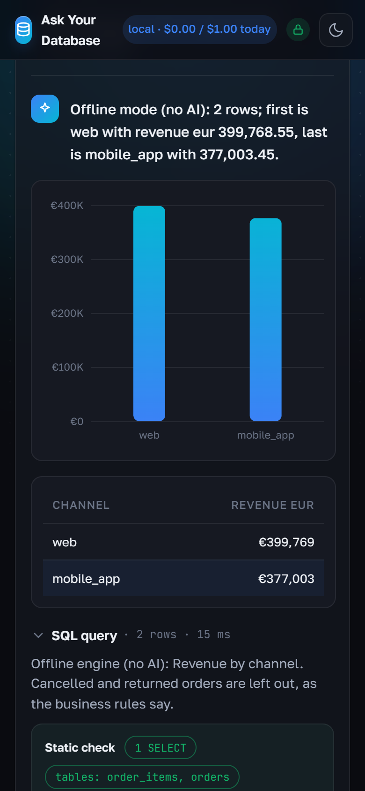

# Ask Your Database

Ask questions about a SQL database in plain language. Claude writes the SQL, the app checks it, runs it **read-only**, and you get a plain-language answer, a table and a chart. Next to it is a dashboard built with hand-written SQL.

Every query, whether Claude wrote it or you edited it, goes through **sqlkit**, a SQL tokenizer, parser and policy checker written by hand for this project. It proves the query is a single read-only `SELECT` over allowed tables and columns before the database sees it, and it rewrites the query to add a row limit. Without an API key the app still works: an **offline NL→SQL engine** answers common question shapes (metric by dimension, with filters, periods and top-N) through the same safety path.

It runs on a **SQLite file or a company's Azure SQL / SQL Server database**, with Microsoft sign-in, an audit log, spending limits, Docker, CI/CD and a one-command deployment to Azure Container Apps.



## Features

**Static SQL check** (`sqlkit/tokenizer.py`, `parser.py`, `policy.py`, `printer.py`)
- A tokenizer for SQLite (strings, `--` and `/* */` comments, `"quoted"`, `[bracketed]` and `` `backtick` `` names, numbers, operators) that keeps positions for error messages.
- A recursive-descent parser for the read-only `SELECT` subset: CTEs (including `WITH RECURSIVE`), joins, subqueries, `UNION`/`INTERSECT`/`EXCEPT`, `CASE`, `CAST`, window functions with frames, `IN`/`BETWEEN`/`LIKE`/`EXISTS`. Anything else (`DELETE`, `PRAGMA`, `ATTACH`, two statements) is refused with a category and a position.
- Scope resolution: every column reference is resolved to its table through aliases, CTEs and subqueries, so `SELECT x.e FROM (SELECT email AS e FROM customers) x` is caught as reading a protected column.
- Allow-lists for tables, columns and functions (no `load_extension`, `randomblob`, `zeroblob`...), a PII deny-list (`customers.email` by default; `SELECT *` over it is refused too), no system tables, no bind parameters.
- Cost guards: maximum nesting depth and join count, an estimate of unfiltered cross products from row counts (`JOIN ... ON 1 = 1` counts as unfiltered), and recursive CTEs without a stop condition.
- Rewrite: `LIMIT max_rows + 1` is added when missing and larger limits are clamped. The printer turns the AST back into canonical SQL; round trips are tested.

**Schema linking** (`sqlkit/linker.py`)
- Matches question words against stored values (cities, categories, products, statuses), with aliases from the semantic layer ("mobile" → `mobile_app`, "cash" → `cash_on_delivery`) and one-edit typo tolerance for longer words ("Plovidv" → Plovdiv).
- Matches the words of metrics and dimensions, and table and column names.
- Connects the linked tables through the foreign-key graph with a greedy Steiner-tree approximation (BFS from the growing tree).
- The result goes into Claude's prompt as short hints, and the UI shows it under every answer.

**Offline NL→SQL** (`sqlkit/nl2sql.py`, `config/shop.semantic.json`)
- Question → frame (metrics, dimensions, value filters, period, top-N, direction) → SQL, compiled from a semantic layer: 12 metrics (revenue, orders, units, customers, new customers, AOV, return rate, gross profit, margin, stock, products, payments) and 9 dimensions.
- Periods: month and year, quarters, "last N days/weeks/months" relative to the latest order.
- It declines what it cannot do ("never", "compare", "median", "share of"...) instead of guessing, and it says so. Replace the JSON file to describe another database.

**Second sample: B2B marketing and sales pipeline** (`seed_pipeline.py`, `config/pipeline.semantic.json`, `config/pipeline.md`)
- Ad spend, GA4 sessions and CRM leads and deals in one database, so it answers "Which channel brought the most pipeline in Q3 2026?", "Win rate by segment" or "Top 5 campaigns by won revenue". Start it with `ASKDB_SAMPLE=pipeline`.
- 21 metrics and 13 dimensions, with the definitions a revenue team argues about written down once: pipeline is dated by when the deal was created, won revenue and win rate by when it closed, win rate ignores open deals.
- The four fact tables have different grains, so the engine never joins two of them: "Spend by segment" is declined instead of returning spend multiplied by deals. Two metrics with different row filters or dates in one question are declined too.
- 40 more eval questions with independent gold SQL (`eval/pipeline.json`): 30 the engine must answer exactly, 10 cross-source ones (cost per opportunity, ROAS, funnel) it must decline.

**Evaluation** (`sqlkit/evaluate.py`, `scripts/benchmark.py`, `eval/`)
- Execution accuracy: the generated query and a hand-written gold query run on the same database, and the result sets are compared as multisets.
- A red-team set of 67 attacks in 8 categories and a benign set, measured against each safety layer alone and combined, with a hash of the database file before and after.

**The app**
- Claude writes the query in the database's own dialect (SQLite or T-SQL), with the schema, foreign keys, column values and business rules from [`config/shop.md`](config/shop.md). If the database reports an error, the error goes back to Claude, which fixes its own query (up to 2 times).
- Claude answers in one or two sentences and suggests a chart. You see the SQL, the static-check verdict and the linking, and can edit and rerun the query (still checked, still read-only).
- Microsoft sign-in, an audit log, per-user history, CSV export, daily spending limits, a dashboard with hand-written SQL, dark and light themes.

## Architecture



## Benchmark

Measured 2026-11-20 on Python 3.12.3, Windows 11, with `python scripts/benchmark.py` (full output: [`examples/benchmark.md`](examples/benchmark.md), raw: [`examples/benchmark.json`](examples/benchmark.json)). Offline mode only; Claude mode was not re-measured.

**Offline NL→SQL execution accuracy (EX).** A question counts as correct when the generated query returns the same rows as the hand-written gold query (order-insensitive, numbers rounded to 2 decimals). A declined question counts as wrong.

| Set | Template-shaped | Beyond templates | All | Precision when answered |
|---|---|---|---|---|
| In-sample: [`eval/questions.json`](eval/questions.json), 42 questions, the engine was tuned on it | 35/36 = 97.2% | 0/6 (declined) | 35/42 = 83.3% | 97.2% |
| Held-out: [`eval/holdout.json`](eval/holdout.json), 17 questions written after the engine was frozen, run once | 14/15 = 93.3% | 0/2 (declined) | 14/17 = 82.4% | 93.3% |

The held-out miss is "Which month had the highest revenue?" (top-N is not applied to time dimensions). The in-sample miss is "Which payment method is used most?". Questions beyond the templates are declined, not guessed.

**Schema linking** (tables found vs tables the gold query reads): recall 97.7% / precision 77.8% in-sample, 98.5% / 84.8% held-out.

**Red team** ([`eval/redteam.json`](eval/redteam.json)): 67 attacks and 92 benign queries (20 controls, every gold query, the dashboard and demo SQL).

| Layer | Attacks blocked | Benign queries blocked |
|---|---|---|
| Static check alone (sqlkit) | 100.0% | 0.0% |
| Runtime layers alone (read-only connection, authorizer, timeout) | 61.2% | 0.0% |
| Both, as shipped | 100.0% | 0.0% |

The runtime layers alone stop every write, but they let through reads of the protected email column (0 of 12), system tables (1 of 8) and some functions; the static check closes those gaps. The database file was unchanged after the run (sha256).

**Latency** (offline, 20 rounds over the 42 questions):

| Step | p50 | p95 |
|---|---|---|
| Static check (tokenize, parse, verify, rewrite) | 0.66 ms | 1.24 ms |
| Schema linking | 3.04 ms | 7.52 ms |
| NL→SQL plan (link, frame, compile) | 4.35 ms | 10.76 ms |
| Guarded execution on shop.db | 5.05 ms | 10.78 ms |
| Offline question, end to end (same path as the web app) | 14.40 ms | 23.38 ms |

**Claude mode** (measured 2026-10-28, [`examples/example-answers.json`](examples/example-answers.json)): all 8 example questions answered on the first attempt, mean 7.8 s per answer, about $0.13 in total, about 70% of input tokens read from the prompt cache. Four were checked by hand against hand-written SQL and matched (Black Friday week vs the week before, return rate by category, city with the highest average order, top 5 products in September 2026 with a three-way tie). Execution accuracy on the eval sets and red-team rates with Claude in the loop: not measured.

## Quick start

```bash
pip install -r requirements.txt
python seed_db.py        # creates shop.db (already in the repo)
python app.py            # http://localhost:5000, offline mode without a key
```

For the B2B pipeline sample instead of the shop:

```bash
python seed_pipeline.py              # creates pipeline.db
ASKDB_SAMPLE=pipeline python app.py  # PowerShell: $env:ASKDB_SAMPLE="pipeline"; python app.py
```

For Claude mode, copy `.env.example` to `.env` and add your API key from https://console.anthropic.com. `DEMO_MODE=1` forces offline mode even when a key is set.

```bash
python scripts/benchmark.py            # writes examples/benchmark.json and .md
python scripts/benchmark.py --quick    # CI smoke run with pass/fail gates
```

With Docker: `docker compose up --build` serves it at http://localhost:8000 (offline without a key).



## Safety: the AI can't change your data

**SQLite**, four independent layers:

| Layer | What it stops |
|---|---|
| **sqlkit static check** before the query reaches SQLite | Writes and DDL, `PRAGMA`, `ATTACH`, two statements, unknown tables and columns, protected columns (also through `*` and subquery aliases), system tables, unsafe functions, unfiltered cross products, unbounded recursion; adds a `LIMIT` |
| The database is opened in **read-only mode** (`mode=ro`) | SQLite itself refuses every write |
| A SQLite **authorizer** allows only reading tables and calling functions | `INSERT`, `UPDATE`, `DELETE`, `DROP`, `ALTER`, `PRAGMA`, `ATTACH`, also when hidden in a `WITH ...` |
| **One statement per call**, a progress-handler **time limit** and `fetchmany` | `SELECT 1; DROP TABLE orders`, runaway queries, huge results |

**Azure SQL / SQL Server**, four independent layers:

| Layer | What it stops |
|---|---|
| A **separate read-only identity** with `SELECT` on the allowed schemas only. At startup the app asks the server for the login's effective permissions (`fn_my_permissions`). In production (`REQUIRE_READ_ONLY=1`) it refuses to run queries, and `/readyz` fails, if the login could write. | Every write, and reading other schemas, such as the app's own audit log |
| A **guard** reads the query before it is sent, ignoring strings, comments and `[quoted]` names. Only one `SELECT`/`WITH` statement is allowed. | `INSERT`, `SELECT ... INTO`, `EXEC`, `xp_cmdshell`, `OPENROWSET`, `WAITFOR`, `DECLARE`, `@@VERSION`, `; DROP` |
| Every query runs in a **transaction that is always rolled back** | Anything that slipped through |
| A **query timeout** on the connection, and only the first rows are fetched | Runaway queries |

There is also a **time limit** (5 seconds) and a **row limit** (500 rows). The question itself is treated as data, not instructions.

## Built for real use

| | |
|---|---|
| **Sign-in** | Microsoft Entra ID through the platform (Container Apps "Easy Auth"), with an optional allowlist. Locally it runs as a single user. |
| **Audit log** | Every question and edited query is stored with who asked it, the SQL, whether it was blocked or failed, the row count, the tokens and the cost. Users see their own history; admins (`ADMIN_USERS`) can open the audit log of everyone. The log lives in the app's own store (SQLite, or schema `askdb` in Azure SQL), apart from the data. |
| **Spending limits** | A daily limit per user and one for the whole app. Failed questions count too, because they cost tokens. |
| **CSV export** | The full result of any past query (up to 10,000 rows), with cells escaped so Excel doesn't run formulas. |
| **Locked-down options** | `ALLOW_CUSTOM_SQL=0` hides "Run edited SQL", so only AI-written queries run. |
| **Health** | `/healthz` (liveness) and `/readyz`, which checks that the database and audit store are reachable and the login is read-only. JSON request logs with request ids. A content security policy with a nonce for the one inline script. |
| **Offline mode** | Without a key (or with `DEMO_MODE=1`) the example questions get SQL written in advance and other questions go to the offline engine. Everything else (checks, queries, history, dashboard) is real. |

## Dashboard: hand-written SQL



Every card has an **SQL** button that shows the query behind it:

- **KPIs for the last 30 days:** revenue, orders, average order, customers and gross profit (3-table `JOIN`)
- **Monthly revenue and growth:** a `WITH` CTE and the `LAG()` window function for month-over-month growth
- **Revenue and margin by category:** `JOIN`s across 4 tables, `GROUP BY`, margin from cost price
- **Top 5 products:** the `RANK()` window function
- **Revenue by city**

## Screenshots

Dark and light themes (toggle in the top bar, remembered in the browser; `?theme=light` or `?theme=dark` forces one), and a layout that works down to phone width.

| Answer (dark) | Answer (light) | Phone |
|---|---|---|
|  |  |  |

Light dashboard: [`examples/screenshot-dashboard-light.png`](examples/screenshot-dashboard-light.png).

## Design decisions

- **A hand-written parser instead of a SQL library.** The check has to understand scopes (which `e` is `customers.email`?), not just keywords, and it must fail closed: anything outside the supported subset is refused. Writing the subset by hand keeps that decision explicit and testable, and it costs 0.66 ms at p50.
- **Defence in depth, measured per layer.** The static check catches everything in the red-team set by itself, but the read-only connection and the authorizer stay on: a parser bug should not be enough to write. The benchmark reports each layer alone so the gaps of each are visible.
- **The offline engine declines rather than guesses.** A wrong number that looks right is worse than "this needs the AI mode". Precision when answered (93.3% held-out) matters more than coverage here.
- **A semantic layer in JSON.** Metric definitions (revenue excludes cancelled and returned orders) live in one file shared by the offline engine and the linker, next to the Markdown rules Claude reads.
- **Honest evaluation.** The in-sample set was used to build the engine; the held-out set was written afterwards and run once. Both are reported.

## Project layout

```
app.py, assistant.py, safe_sql.py   Flask app, Claude flow, database sources and runtime guards
sqlkit/                             tokenizer, parser, printer, policy, catalog, linker, nl2sql, evaluate
config/                             business rules for Claude (shop.md, pipeline.md) and the semantic layers (*.semantic.json)
eval/                               questions.json (in-sample), holdout.json, redteam.json, pipeline.json
seed_db.py, seed_pipeline.py        the two sample databases
scripts/benchmark.py                writes examples/benchmark.json and .md
demo.py, dashboard.py, store.py     offline client, dashboard SQL, audit store
infra/                              Bicep, deploy script, SQL grants
tests/                              pytest, fake Claude client, no network
```

## The sample databases

`seed_db.py` creates `shop.db`, a fictional online shop in Bulgaria with repeatable random data:

| Table | Rows | Notes |
|---|---|---|
| categories | 7 | Laptops, Phones, Audio, Monitors, Accessories, Smart Home, Kitchen |
| products | 36 | price, cost price, stock |
| customers | 800 | 11 Bulgarian cities |
| orders | 3,140 | May 2025 – Oct 2026; statuses and channels (web / mobile app) |
| order_items | 4,334 | quantity and price paid |
| payments | 2,991 | card, cash on delivery, bank transfer |

The data has realistic patterns: growth over time, a Black Friday and Christmas peak, a shift to the mobile app in 2026, and a few very loyal customers.

The same data loads into Azure SQL, in schema `shop`, with `python seed_db.py --target mssql://...`. The dashboard has a T-SQL version of every query, and a test checks that it gives exactly the same numbers on Azure SQL as on SQLite.

### B2B pipeline sample

`seed_pipeline.py` creates `pipeline.db`: a fictional B2B SaaS company (invoice automation for finance teams) with the three sources a marketing team reports on. `ASKDB_SAMPLE=pipeline` selects the database, its rules, its semantic layer and the denied column (`contacts.email`) together.

| Table | Rows | Notes |
|---|---|---|
| channels | 9 | LinkedIn Ads, Google Ads, Meta Ads, 6sense ABM (paid); Organic Search, Direct, Referral, Email, Events |
| campaigns | 17 | belong to a channel |
| ad_spend | 5,151 | daily cost, impressions and clicks per campaign |
| ga4_sessions | 14,661 | daily sessions, engaged sessions and conversions per channel and device |
| accounts | 500 | segment (SMB, Mid-Market, Enterprise), industry, country |
| contacts | 6,323 | leads with original-source channel, job title, MQL date |
| deals | 603 | stage, owner, amount, created and closed dates, May 2025 – Oct 2026 |

The patterns are the ones such data usually has: LinkedIn and ABM deals are more than twice the size of Google Ads deals, Meta brings many leads that rarely qualify (12% become MQLs, against 48% for ABM), enterprise deals take about three times longer to close than SMB, and mobile traffic converts worst. Without a key the app answers metric-by-dimension questions with the offline engine and two cross-source examples (pipeline per euro of ad spend, the lead-to-won funnel) with SQL written in advance; with a key Claude gets `config/pipeline.md`, which tells it to aggregate each source in its own CTE before joining. This sample is SQLite only, and the dashboard below belongs to the shop.

### Your own data

To use your own data, set `ASKDB_DATABASE` to any SQLite file or Azure SQL database, with `?schemas=` for the schemas the assistant may see. Write your business rules into a Markdown file and point `ASKDB_CONTEXT` at it; for the offline engine, describe your metrics in a semantic-layer JSON file and point `ASKDB_SEMANTIC` at it. The hand-written dashboard belongs to the sample shop, so it hides itself on other databases.

### Your Azure SQL database

```bash
az login
python seed_db.py --target "mssql://<server>.database.windows.net/<database>"   # optional: the sample shop
ASKDB_DATABASE="mssql://<server>.database.windows.net/<database>?schemas=shop" python app.py
```

Locally the app signs in with your Azure CLI account. It logs a warning if that account could write. In Azure it uses its own read-only identity.

## Deploy to Azure

`infra/deploy.ps1` deploys everything with one command (Bicep: [`infra/main.bicep`](infra/main.bicep)):

- **Two managed identities, no passwords:**
  - the *app* identity reads the API key from Key Vault and writes the audit log;
  - the *reader* identity runs the questions' SQL with `SELECT` on the data schemas only.

  [`infra/grant_sql_access.py`](infra/grant_sql_access.py) creates both database users with exactly those rights.
- **The API key stays in Key Vault**, and you add it yourself. The script stops and tells you how if it's missing.
- **Hosting:** Azure Container Apps that scales to zero when idle, Microsoft sign-in, `REQUIRE_READ_ONLY=1`, and logs in Log Analytics with a daily cap.

```powershell
./infra/deploy.ps1 -ResourceGroup rg-askdb -SqlServer <server> -SqlDatabase <database> -Schemas shop `
    -Image ghcr.io/momchilborisov05-eng/ask-your-database:latest -AllowedUsers "me@example.com" -AdminUsers "me@example.com"
```

**CI/CD** ([`.github/workflows/ci.yml`](.github/workflows/ci.yml)) runs on every push:
1. ruff;
2. tests with coverage on Python 3.11–3.13, then the benchmark smoke run (fails if an attack gets through, the database changes, or template accuracy drops below 90%);
3. a Docker build (multi-stage, non-root, healthcheck), then a smoke test that starts the container offline, asks an example question and a free question, and checks that a PII query is blocked;
4. on `main`, a push to GitHub Container Registry and a rollout to Container Apps through OpenID Connect, with no stored Azure secret.

### Configuration

| Variable | Default | |
|---|---|---|
| `ASKDB_SAMPLE` | `shop` | `pipeline` switches the four defaults below to the B2B pipeline sample |
| `ASKDB_DATABASE` | `sqlite:///shop.db` | The database to ask about; `mssql://host/db?schemas=a,b` for Azure SQL |
| `READER_CLIENT_ID` | – | Client id of the read-only managed identity (Azure) |
| `ASKDB_STORE` | `sqlite:///askdb.db` | The audit log; `mssql://host/db` uses schema `askdb` |
| `ASKDB_CONTEXT` | `config/shop.md` | Business rules and definitions for the model |
| `ASKDB_SEMANTIC` | `config/shop.semantic.json` | Semantic layer for the offline engine and the linker |
| `ASKDB_DENY_COLUMNS` | `customers.email` | Columns no query may read (comma-separated `table.column`) |
| `ASKDB_STATIC_CHECK` | `1` | `0` turns the sqlkit check off (runtime layers stay on) |
| `AUTH_MODE` | `none` | `easyauth` behind Container Apps / App Service sign-in |
| `ALLOWED_USERS`, `ADMIN_USERS` | – | Comma-separated sign-in names |
| `DAILY_BUDGET_USD`, `DAILY_BUDGET_TOTAL_USD` | `1.00`, `5.00` | Spending limits per user and for the app |
| `REQUIRE_READ_ONLY` | `0` | `1`: refuse to run queries if the login could write |
| `ALLOW_CUSTOM_SQL` | `1` | `0`: only AI-written queries run |
| `CLAUDE_MODEL` | `claude-opus-5-5` | |
| `DEMO_MODE` | `0` | `1`: offline mode even when a key is set |

## Tests

```bash
pip install -r requirements.txt -r requirements-dev.txt
pytest --cov
ASKDB_TEST_MSSQL="mssql://<server>.database.windows.net/<db>?schemas=shop" pytest   # plus the Azure SQL test
```

159 tests pass offline (plus one optional test against Azure SQL, skipped without a server); line coverage is 86%. The tests use a fake Claude client and never touch the network.

- **sqlkit:** tokenizer positions and quoting, parser errors, printer round trips (and operator precedence checked by running the printed SQL), every policy category, PII through `*` and subquery aliases, LIMIT injection and clamping, bounded vs unbounded recursion.
- **Linking and offline NL→SQL:** values, aliases and typos, the FK join path, prompt hints, frames with filters, periods and top-N, results checked against gold SQL, declines.
- **The pipeline sample:** the seed is deterministic and consistent, the engine equals gold SQL on 30 questions and declines 10, won metrics use the close date, fact tables are never joined, `contacts.email` is blocked, and the app answers it offline end to end.
- **Evaluation:** result-set comparison, a red-team smoke run, every gold query passes the static check, and the benchmark's quick mode.
- **SQL safety in the app:** dangerous queries blocked in SQLite (with the data checked afterwards) and in the T-SQL guard; Azure SQL queries time-limited and always rolled back; the read-only login check.
- **The AI flow:** answers, self-correction after an SQL error, refusing writes, unanswerable questions, invalid chart columns, dialect-specific prompts, and offline mode end to end.
- **Sign-in, history and the audit log**, daily limits, CSV export, the dashboard (including the `LAG()` growth formula) and the CSP nonce.

## Limitations

- **The parser covers SQLite's read-only subset only.** Azure SQL queries go through a separate, keyword-level T-SQL guard plus the database's own permissions; sqlkit does not parse T-SQL.
- **The offline engine handles metric-by-dimension questions** for the configured semantic layer. Comparisons, "never", medians, shares, per-customer averages and relative dates like "last month" are declined (0 of 8 such questions answered in the eval sets). Top-N on a time dimension is not supported.
- **The pipeline sample has no held-out set.** Its 40 questions were used to tune its semantic layer, so "30 of 30" is a regression check, not an accuracy estimate; the benchmark numbers above are for the shop only. Its attribution is original source only (no multi-touch), and Claude mode was not run on it.
- **The eval sets are small and written by one person** (42 in-sample, 17 held-out). The in-sample numbers are optimistic because the engine was tuned on them.
- **Claude mode was not re-measured** for this version (paid API). Its execution accuracy on the eval sets and its behaviour under the red team are not measured; the only Claude numbers are from the 8 example questions on 2026-10-28.
- **Not verified here:** the Docker image, docker compose and the CI workflow (Docker is not installed on the machine where this was built), and the Azure deployment for this version.
- Latency was measured on one Windows laptop; your numbers will differ.
