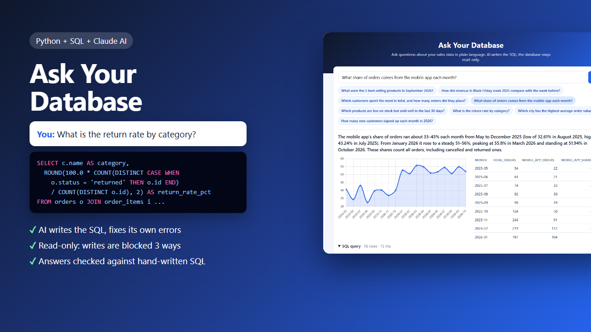
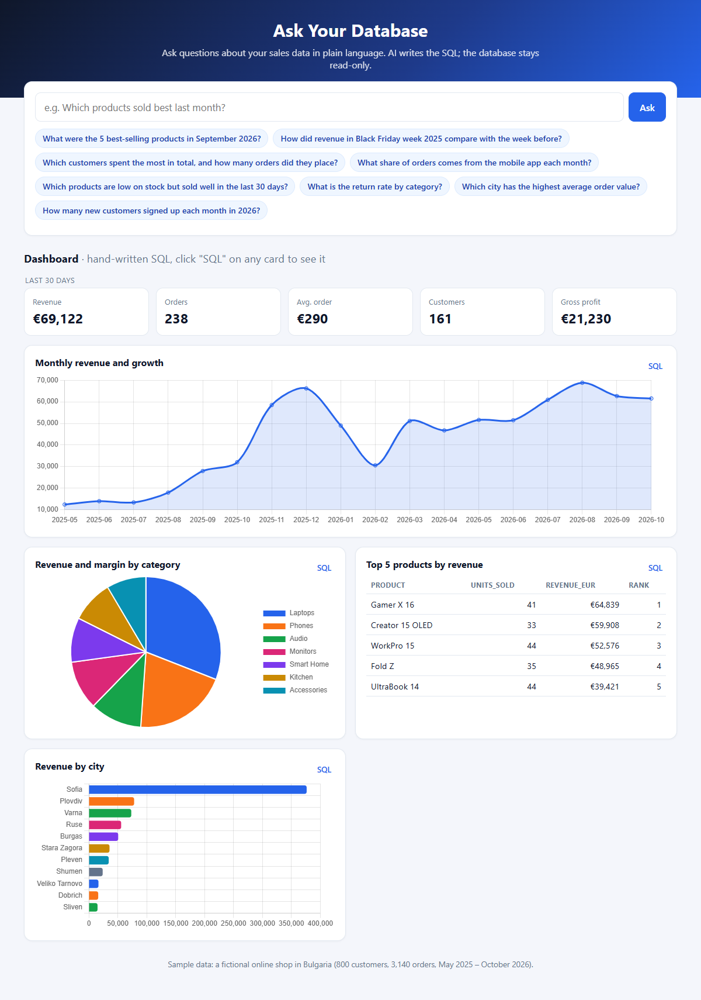

# Ask Your Database

Ask questions about a SQL database in plain language. Claude writes the SQL, the app runs it **read-only**, and you get a plain-language answer, a table and a chart. Next to it is a dashboard built with hand-written SQL.



## What it does

You type a question, or click one of the example questions:

> *What is the return rate by category?*

1. **Claude writes a SQLite query.** It knows the schema, the column values (statuses, cities, categories) and the business rules, for example that revenue excludes cancelled and returned orders.
2. **The query runs safely**, read-only, with a row limit and a time limit.
3. **If SQLite reports an error**, the error goes back to Claude, which fixes its own query (up to 2 times).
4. **Claude answers in one or two sentences** using the numbers from the result, and suggests a chart (line, bar, pie or none).
5. **You see the SQL**, can edit it and run it again. The edited query is still read-only.

> Laptops have the highest return rate at 5.62% (10 of 178 orders), followed by Smart Home at 3.94% and Accessories at 3.35%... Phones have the lowest at 2.13%.

## Safety: the AI can't change your data

Three independent layers:

| Layer | What it stops |
|---|---|
| The database is opened in **read-only mode** (`mode=ro`) | SQLite itself refuses every write |
| A SQLite **authorizer** allows only reading tables and calling functions | `INSERT`, `UPDATE`, `DELETE`, `DROP`, `ALTER`, `PRAGMA`, `ATTACH`, also when hidden in a `WITH ...` |
| **One statement per call** | `SELECT 1; DROP TABLE orders` |

There is also a **time limit** (queries are stopped after 5 seconds) and a **row limit** (500 rows). The tests try 10 dangerous queries and check that the data is unchanged.

## Tested with real questions

All 8 example questions were answered on the first attempt. Four were checked against hand-written SQL:

| Question | Result |
|---|---|
| Revenue in Black Friday week 2025 vs the week before | ✓ €12,635.25 (65 orders) vs €18,711.75 (47 orders) |
| Return rate by category | ✓ all 7 categories match |
| City with the highest average order value | ✓ Pleven, €404.54 |
| 5 best-selling products in September 2026 | ✓ correct, with a three-way tie at 21 units for 4th place. The prompt now asks the AI to keep and mention ties. |

The full answers, SQL and timings are in [`examples/example-answers.json`](examples/example-answers.json). The 8 questions together cost about $0.13. The schema is prompt-cached, so about 70% of the input tokens were read from the cache.

## Dashboard: hand-written SQL



Every card has an **SQL** button that shows the query behind it:

- **KPIs for the last 30 days:** revenue, orders, average order, customers and gross profit (3-table `JOIN`)
- **Monthly revenue and growth:** a `WITH` CTE and the `LAG()` window function for month-over-month growth
- **Revenue and margin by category:** `JOIN`s across 4 tables, `GROUP BY`, margin from cost price
- **Top 5 products:** the `RANK()` window function
- **Revenue by city**

## The sample database

`seed_db.py` creates `shop.db`, a fictional online shop in Bulgaria with repeatable random data:

| Table | Rows | Notes |
|---|---|---|
| categories | 7 | Laptops, Phones, Audio, Monitors, Accessories, Smart Home, Kitchen |
| products | 36 | price, cost price, stock |
| customers | 800 | 11 Bulgarian cities |
| orders | 3,140 | May 2025 – Oct 2026; statuses and channels (web / mobile app) |
| order_items | 4,334 | quantity and price paid |
| payments | 2,991 | card, cash on delivery, bank transfer |

The data has realistic patterns: growth over time, a Black Friday and Christmas peak, a shift to the mobile app in 2026, and a few very loyal customers.

To use your own data, point `create_app()` at any SQLite file. The schema description is built automatically.

## Setup

```bash
pip install -r requirements.txt
cp .env.example .env     # Windows: copy .env.example .env
# add your API key from https://console.anthropic.com to .env

python seed_db.py        # creates shop.db
python app.py            # http://localhost:5000
```

The dashboard works without an API key; only the AI questions need one.

## Tech stack

Python, Flask, SQLite (CTEs, window functions, an authorizer and read-only mode), vanilla JavaScript, Chart.js, and the Claude API (Structured Outputs, prompt caching).

## Tests

```bash
python -m unittest discover tests
```

12 offline tests: 10 blocked dangerous queries with the data checked afterwards, row and time limits, the dashboard SQL (including the `LAG()` growth formula), and the AI flow with a fake client (answers, self-correction after an SQL error, refusing writes, unanswerable questions, invalid chart columns, read-only edited SQL).
