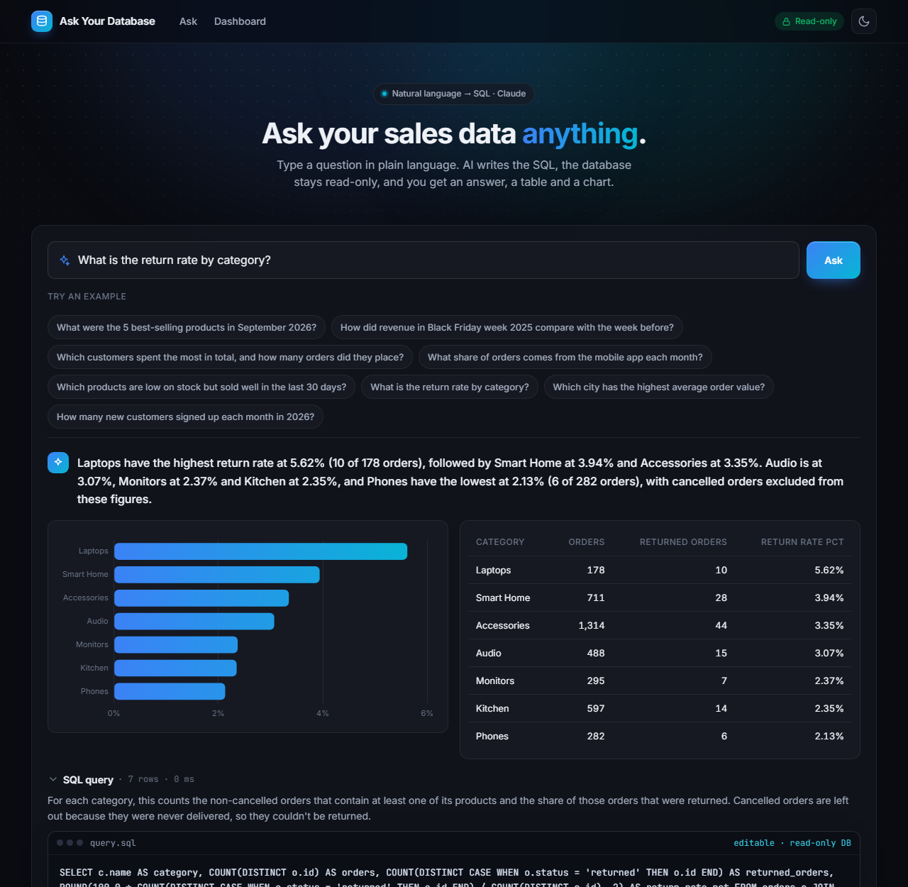
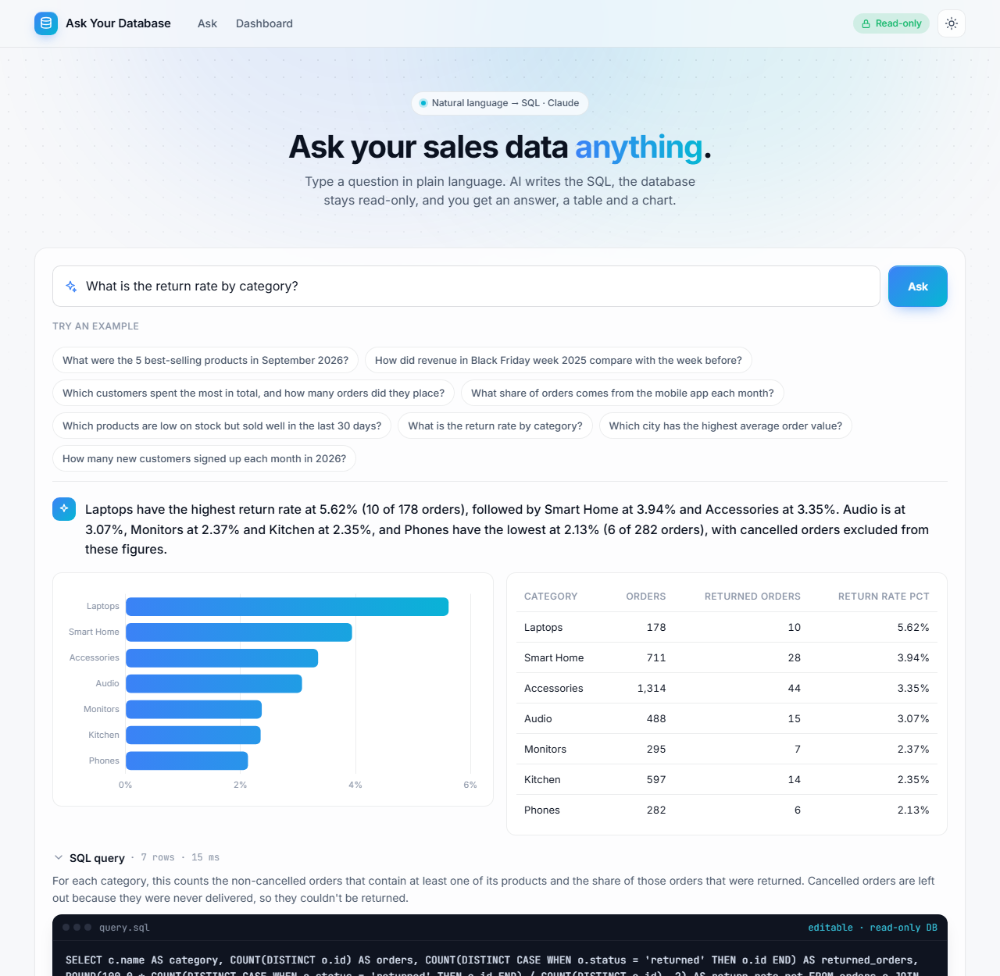
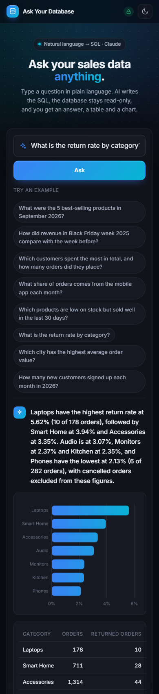

# Ask Your Database

Ask questions about a SQL database in plain language. Claude writes the SQL, the app runs it **read-only**, and you get a plain-language answer, a table and a chart. Next to it is a dashboard built with hand-written SQL.

It runs on a **SQLite file or a company's Azure SQL / SQL Server database**. It is built for real use:
- Microsoft sign-in, and a read-only database login that the app checks.
- An **audit log** of every question and query, plus per-user history and CSV export.
- Daily spending limits.
- Docker, CI/CD, and a one-command deployment to Azure Container Apps.


## What it does

You type a question, or click one of the example questions:

> *What is the return rate by category?*

1. **Claude writes a query in the database's own dialect** (SQLite or T-SQL). It knows the schema, the foreign keys, the column values (statuses, cities, categories) and the company's business rules. The rules live in a Markdown file, [`config/shop.md`](config/shop.md), for example that revenue excludes cancelled and returned orders. Replace that file to teach it your own definitions, with no code changes.
2. **The query runs safely**, read-only, with a row limit and a time limit.
3. **If the database reports an error**, the error goes back to Claude, which fixes its own query (up to 2 times).
4. **Claude answers in one or two sentences** using the numbers from the result, and suggests a chart (line, bar, pie or none).
5. **You see the SQL**, can edit it and run it again. The edited query is still read-only.

> Laptops have the highest return rate at 5.62% (10 of 178 orders), followed by Smart Home at 3.94% and Accessories at 3.35%... Phones have the lowest at 2.13%.

## Safety: the AI can't change your data

**SQLite**, three independent layers:

| Layer | What it stops |
|---|---|
| The database is opened in **read-only mode** (`mode=ro`) | SQLite itself refuses every write |
| A SQLite **authorizer** allows only reading tables and calling functions | `INSERT`, `UPDATE`, `DELETE`, `DROP`, `ALTER`, `PRAGMA`, `ATTACH`, also when hidden in a `WITH ...` |
| **One statement per call** | `SELECT 1; DROP TABLE orders` |

**Azure SQL / SQL Server**, four independent layers:

| Layer | What it stops |
|---|---|
| A **separate read-only identity** with `SELECT` on the allowed schemas only. At startup the app asks the server for the login's effective permissions (`fn_my_permissions`). In production (`REQUIRE_READ_ONLY=1`) it refuses to run queries, and `/readyz` fails, if the login could write. | Every write, and reading other schemas, such as the app's own audit log |
| A **guard** reads the query before it is sent, ignoring strings, comments and `[quoted]` names. Only one `SELECT`/`WITH` statement is allowed. | `INSERT`, `SELECT ... INTO`, `EXEC`, `xp_cmdshell`, `OPENROWSET`, `WAITFOR`, `DECLARE`, `@@VERSION`, `; DROP` |
| Every query runs in a **transaction that is always rolled back** | Anything that slipped through |
| A **query timeout** on the connection, and only the first rows are fetched | Runaway queries |

There is also a **time limit** (5 seconds) and a **row limit** (500 rows). The question itself is treated as data, not instructions. The tests try dangerous queries in both dialects and check that the data is unchanged.

## Built for real use

| | |
|---|---|
| **Sign-in** | Microsoft Entra ID through the platform (Container Apps "Easy Auth"), with an optional allowlist. Locally it runs as a single user. |
| **Audit log** | Every question and edited query is stored with who asked it, the SQL, whether it was blocked or failed, the row count, the tokens and the cost. Users see their own history; admins (`ADMIN_USERS`) can open the audit log of everyone. The log lives in the app's own store (SQLite, or schema `askdb` in Azure SQL), apart from the data. |
| **Spending limits** | A daily limit per user and one for the whole app. Failed questions count too, because they cost tokens. |
| **CSV export** | The full result of any past query (up to 10,000 rows), with cells escaped so Excel doesn't run formulas. |
| **Locked-down options** | `ALLOW_CUSTOM_SQL=0` hides "Run edited SQL", so only AI-written queries run. |
| **Health** | `/healthz` (liveness) and `/readyz`, which checks that the database and audit store are reachable and the login is read-only. JSON request logs with request ids. A content security policy with a nonce for the one inline script. |
| **Demo mode** | `DEMO_MODE=1` runs without an API key. The example questions get SQL written in advance, and everything else (queries, history, dashboard) is real. |

## Tested with real questions

All 8 example questions were answered on the first attempt. Four were checked against hand-written SQL:

| Question | Result |
|---|---|
| Revenue in Black Friday week 2025 vs the week before | ✓ €12,635.25 (65 orders) vs €18,711.75 (47 orders) |
| Return rate by category | ✓ all 7 categories match |
| City with the highest average order value | ✓ Pleven, €404.54 |
| 5 best-selling products in September 2026 | ✓ correct, with a three-way tie at 21 units for 4th place. The prompt now asks the AI to keep and mention ties. |

The full answers, SQL and timings are in [`examples/example-answers.json`](examples/example-answers.json). The 8 questions together cost about $0.13. The schema is prompt-cached, so about 70% of the input tokens were read from the cache.

## Dashboard: hand-written SQL


Every card has an **SQL** button that shows the query behind it:

- **KPIs for the last 30 days:** revenue, orders, average order, customers and gross profit (3-table `JOIN`)
- **Monthly revenue and growth:** a `WITH` CTE and the `LAG()` window function for month-over-month growth
- **Revenue and margin by category:** `JOIN`s across 4 tables, `GROUP BY`, margin from cost price
- **Top 5 products:** the `RANK()` window function
- **Revenue by city**

## Screenshots

The interface has a dark and a light theme (toggle in the top bar, remembered in the browser; `?theme=light` or `?theme=dark` forces one), smooth GSAP animations and a layout that works down to phone width.

| Answer (dark) | Answer (light) | Phone |
|---|---|---|
|  |  |  |

Light dashboard: [`examples/screenshot-dashboard-light.png`](examples/screenshot-dashboard-light.png).

## The sample database

`seed_db.py` creates `shop.db`, a fictional online shop in Bulgaria with repeatable random data:

| Table | Rows | Notes |
|---|---|---|
| categories | 7 | Laptops, Phones, Audio, Monitors, Accessories, Smart Home, Kitchen |
| products | 36 | price, cost price, stock |
| customers | 800 | 11 Bulgarian cities |
| orders | 3,140 | May 2025 – Oct 2026; statuses and channels (web / mobile app) |
| order_items | 4,334 | quantity and price paid |
| payments | 2,991 | card, cash on delivery, bank transfer |

The data has realistic patterns: growth over time, a Black Friday and Christmas peak, a shift to the mobile app in 2026, and a few very loyal customers.

The same data loads into Azure SQL, in schema `shop`, with `python seed_db.py --target mssql://...`. The dashboard has a T-SQL version of every query, and a test checks that it gives exactly the same numbers on Azure SQL as on SQLite.

To use your own data, set `ASKDB_DATABASE` to any SQLite file or Azure SQL database, with `?schemas=` for the schemas the assistant may see. Then write your business rules into a Markdown file and point `ASKDB_CONTEXT` at it. The schema description is built automatically. The hand-written dashboard belongs to the sample shop, so it hides itself on other databases.

## Setup

```bash
pip install -r requirements.txt
cp .env.example .env     # Windows: copy .env.example .env
# add your API key from https://console.anthropic.com to .env (or set DEMO_MODE=1)

python seed_db.py        # creates shop.db
python app.py            # http://localhost:5000
```

With Docker: `docker compose up --build` serves it at http://localhost:8000 (in demo mode without a key).

### Your Azure SQL database

```bash
az login
python seed_db.py --target "mssql://<server>.database.windows.net/<database>"   # optional: the sample shop
ASKDB_DATABASE="mssql://<server>.database.windows.net/<database>?schemas=shop" python app.py
```

Locally the app signs in with your Azure CLI account. It logs a warning if that account could write. In Azure it uses its own read-only identity.

## Deploy to Azure

`infra/deploy.ps1` deploys everything with one command (Bicep: [`infra/main.bicep`](infra/main.bicep)):

- **Two managed identities, no passwords:**
  - the *app* identity reads the API key from Key Vault and writes the audit log;
  - the *reader* identity runs the questions' SQL with `SELECT` on the data schemas only.

  [`infra/grant_sql_access.py`](infra/grant_sql_access.py) creates both database users with exactly those rights.
- **The API key stays in Key Vault**, and you add it yourself. The script stops and tells you how if it's missing.
- **Hosting:**
  - Azure Container Apps that scales to zero when idle;
  - Microsoft sign-in;
  - `REQUIRE_READ_ONLY=1`;
  - logs in Log Analytics with a daily cap.

```powershell
./infra/deploy.ps1 -ResourceGroup rg-askdb -SqlServer <server> -SqlDatabase <database> -Schemas shop `
    -Image ghcr.io/momchilborisov05-eng/ask-your-database:latest -AllowedUsers "me@example.com" -AdminUsers "me@example.com"
```

**CI/CD** ([`.github/workflows/ci.yml`](.github/workflows/ci.yml)) runs on every push:
1. ruff;
2. tests on Python 3.11–3.13;
3. a Docker build, then a smoke test that starts the container in demo mode and asks a question;
4. on `main`, a push to GitHub Container Registry and a rollout to Container Apps through OpenID Connect, with no stored Azure secret.

### Configuration

| Variable | Default | |
|---|---|---|
| `ASKDB_DATABASE` | `sqlite:///shop.db` | The database to ask about; `mssql://host/db?schemas=a,b` for Azure SQL |
| `READER_CLIENT_ID` | – | Client id of the read-only managed identity (Azure) |
| `ASKDB_STORE` | `sqlite:///askdb.db` | The audit log; `mssql://host/db` uses schema `askdb` |
| `ASKDB_CONTEXT` | `config/shop.md` | Business rules and definitions for the model |
| `AUTH_MODE` | `none` | `easyauth` behind Container Apps / App Service sign-in |
| `ALLOWED_USERS`, `ADMIN_USERS` | – | Comma-separated sign-in names |
| `DAILY_BUDGET_USD`, `DAILY_BUDGET_TOTAL_USD` | `1.00`, `5.00` | Spending limits per user and for the app |
| `REQUIRE_READ_ONLY` | `0` | `1`: refuse to run queries if the login could write |
| `ALLOW_CUSTOM_SQL` | `1` | `0`: only AI-written queries run |
| `CLAUDE_MODEL` | `claude-opus-5-5` | |
| `DEMO_MODE` | `0` | `1`: no API key needed |

## Tech stack

- Python, Flask and gunicorn.
- SQLite (CTEs, window functions, an authorizer and read-only mode) and Azure SQL (T-SQL, Microsoft Entra ID with managed identities, `mssql-python`).
- Vanilla JavaScript, Chart.js and GSAP.
- The Claude API: Structured Outputs and prompt caching.
- Docker, GitHub Actions, Bicep, Azure Container Apps and Key Vault.

## Tests

```bash
pip install -r requirements.txt -r requirements-dev.txt
pytest
ASKDB_TEST_MSSQL="mssql://<server>.database.windows.net/<db>?schemas=shop" pytest   # plus the Azure SQL test
```

45 offline tests use a fake Claude client, so they cost nothing (plus one optional test against Azure SQL):

- **SQL safety:** dangerous queries blocked in SQLite (with the data checked afterwards) and in the T-SQL guard, while keywords inside strings and quoted names are still allowed. Azure SQL queries are time-limited and always rolled back. The read-only login check is tested against several permission sets.
- **The AI flow:** answers, self-correction after an SQL error, refusing writes, unanswerable questions, invalid chart columns, and dialect-specific prompts.
- **Sign-in, history and the audit log:**
  - sign-in and the allowlist;
  - the audit log of successful, failed and blocked queries with their cost;
  - users seeing only their own history, while admins see everyone's;
  - daily limits;
  - refusing to run on a login that could write.
- **The rest:** CSV export, demo mode for every example question, the dashboard (including the `LAG()` growth formula) and the CSP nonce.

The optional Azure SQL test loads nothing itself. Against a database seeded with `--target`, it checks the schema description, the guard and the permission check, and that the T-SQL dashboard matches the SQLite one number for number.
